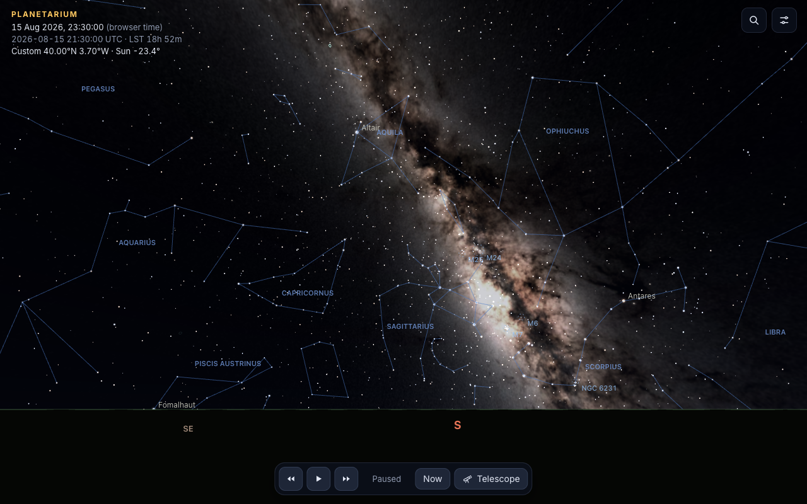
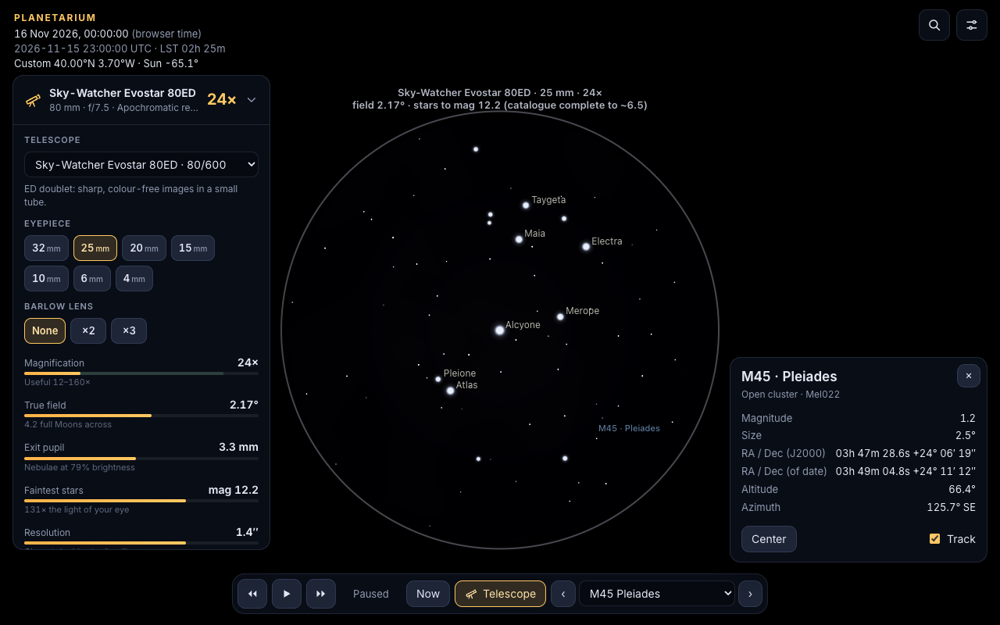
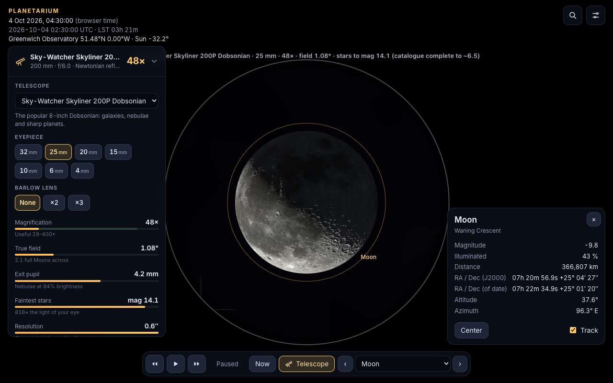
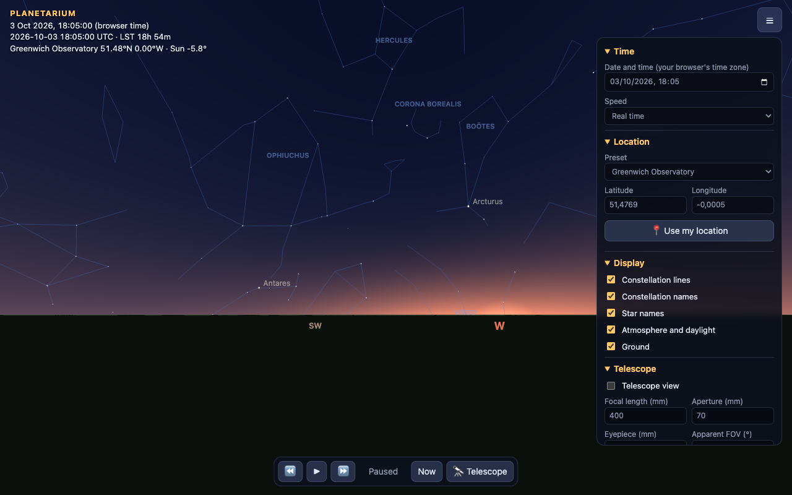

# Planetarium

A web planetarium that shows the real sky for any date, time and place, with a telescope eyepiece simulator for small refractors.



| Telescope view: Pleiades, 25 mm eyepiece | Telescope view: Moon, 10 mm eyepiece |
| --- | --- |
|  |  |



**Live demo:** [pscactux.github.io/planetarium](https://pscactux.github.io/planetarium/)

Built with Vite, TypeScript and three.js. No backend, no tracking, no API keys.

## Features

- The sky from the ground: drag to look around, scroll or pinch to zoom, ground with a horizon and cardinal points.
- About 9,100 stars from the Yale Bright Star Catalogue, sized by magnitude and tinted by colour index (B−V).
- Constellation lines and names, plus IAU names for about 160 bright stars (each one can be switched off).
- Sun, Moon (a lit sphere, so the phase and its orientation come out right) and the planets Mercury to Neptune.
- Sky colour from the Sun's altitude: night, twilight glow towards the Sun, and daylight. Fewer stars show as the sky gets brighter.
- Time controls: now, pause, run forwards or backwards at up to 1 day per second, and a date and time picker.
- Location: geolocation (rounded to about 1 km and never stored), manual latitude and longitude, and a few presets (Greenwich Observatory is the default).
- Click any star or planet to see its name, magnitude, RA/Dec (J2000 and of date), altitude and azimuth. You can centre it or track it.
- **Telescope view.** Set the focal length and aperture of the telescope and the focal length and apparent field of the eyepiece. The defaults match a 70/400 refractor with a 10 mm, 52° eyepiece, and there are presets for 25, 10 and 6 mm eyepieces. The view shows the circular true field and lists the magnification, exit pupil, focal ratio, limiting magnitude, useful magnification range and Dawes limit. There is an option to flip the image 180°, as a straight-through refractor does. A warning appears if the Sun is near the field.
- **Telescope targets.** Switching to the telescope view always aims at something: the selected object if it is up, otherwise Vega at night or the brightest visible object in daylight, and the view then tracks it. A selector in the bottom bar (or the `[` and `]` keys) steps through the targets that are currently above the horizon, away from the Sun and bright enough to see: the Moon, the planets and about 25 classic eyepiece stars such as Albireo, Mizar and the Pleiades. Clicking an object inside the eyepiece re-aims the telescope at it.
- Shareable views through the query string, for example
  `?t=2026-10-04T02:30:00Z&target=alcyone&scope=1&eye=25`
  (`t`, `lat`, `lon`, `az`, `alt`, `fov`, `scope`, `eye`, `target`, `paused`, `panel`).

## Run it

```sh
npm install
npm run dev        # http://localhost:5173/planetarium/
npm test           # astronomy unit tests (Vitest)
npm run build      # type-check and production build into dist/
npm run data       # optional: regenerate public/data/ from the source catalogues
```

Pushing to `main` deploys to GitHub Pages through `.github/workflows/pages.yml`. Set **Settings → Pages → Source** to "GitHub Actions". The site is built with the base path `/planetarium/`.

## How it works

All the astronomy is in `src/astro/` as small, framework-free functions. The tests in `tests/astro.test.ts` check them against worked examples from Jean Meeus, *Astronomical Algorithms*.

- **Julian date.** Unix milliseconds / 86400000 + 2440587.5. TT is taken as UT + 69 s, which is close enough for the Moon.
- **Sidereal time.** Greenwich mean sidereal time from Meeus eq. 12.4. Local sidereal time adds the east longitude. It matches Meeus 12.a and 12.b to 0.001 s.
- **Precession.** IAU 1976 angles ζ, z and θ (Meeus 21.2), applied as a 3×3 rotation from J2000 to the mean equinox of date. It reproduces Meeus 21.b (θ Persei, 2028) to 0.01″. Nutation and aberration (both under 1′) are ignored.
- **RA/Dec to Alt/Az.** The hour angle is H = LST − RA, which gives sin(alt) = sin φ sin δ + cos φ cos δ cos H. The renderer does the same thing as one matrix: `[east; zenith; south] · Rz(−LST) · precession`. Applied to the star group in three.js, it turns the whole sky in a single transform. A test checks that the matrix path and the spherical trigonometry agree, and that Venus in Meeus 13.b comes out within 0.001°. The small difference is because Meeus uses apparent sidereal time.
- **Planets.** Keplerian elements and their rates from JPL ("Approximate Positions of the Planets", valid 1800–2050). The code solves Kepler's equation, rotates the orbit into J2000 ecliptic coordinates, subtracts the Earth, corrects once for light time and rotates by the obliquity. Venus is within about 2″ of Meeus 33.a. Magnitudes use the phase-angle formulas in Meeus ch. 41, with Saturn's rings ignored.
- **Sun.** This is the Earth's orbit from the same table, seen the other way round. It is within 5″ of Meeus 25.a.
- **Moon.** The 24 largest longitude and distance terms and the 13 largest latitude terms of Meeus ch. 47. These match example 47.a to 0.002° and 41 km. Topocentric parallax (up to 1°) is applied by subtracting the observer's position. The phase comes from lighting a sphere with a directional light placed at the Sun.
- **Star brightness.** The relative flux against the current limiting magnitude is 10^(0.4·(m_lim − m)). Point size grows with flux^0.27, and stars near the limit fade instead of shrinking. Colour goes from B−V to temperature (Ballesteros 2012) to an RGB blackbody fit, then is softened towards white.
- **Sky brightness.** The naked-eye limiting magnitude goes from 6.5 when the Sun is below −18° to about −3 in full daylight, interpolated piecewise between those points. The sky dome shader mixes night, twilight and day gradients from the Sun's altitude.
- **Telescope maths.** These are the usual rules of thumb:
  - magnification M = F_telescope / F_eyepiece
  - true field = AFOV / M
  - exit pupil = D / M
  - maximum useful magnification ≈ 2 × D(mm)
  - minimum useful magnification = D / 7 mm
  - limiting magnitude ≈ 2.7 + 5·log₁₀ D(mm), so ≈ 11.9 for 70 mm
  - Dawes limit = 116″ / D(mm)

  The camera's field of view is set so that the true field fills 90% of the shorter side of the screen. The telescope gains the same number of magnitudes over the eye whatever the sky brightness.

## Data sources and licences

| Data | Source | Licence |
| --- | --- | --- |
| Stars (`public/data/stars.json`) | Yale Bright Star Catalogue, 5th rev. ed. (Hoffleit & Warren 1991), CDS [V/50](https://cdsarc.cds.unistra.fr/viz-bin/cat/V/50) | Public domain |
| Star names | IAU Working Group on Star Names (mapping written by hand in `scripts/star-names.mjs`) | Facts, no licence needed |
| Constellation lines and label positions (`public/data/constellations.json`) | [d3-celestial](https://github.com/ofrohn/d3-celestial) by Olaf Frohn, based on the IAU charts | BSD 3-Clause, notice in `public/data/NOTICE.txt` |
| Planet orbital elements | E. M. Standish, JPL Solar System Dynamics | Public domain (US Government) |
| Algorithms | J. Meeus, *Astronomical Algorithms*, 2nd ed. | Formulas, reimplemented |

The code is MIT licensed (see `LICENSE`).

## Limitations

- The Bright Star Catalogue is complete only to magnitude 6.5. The telescope view reports a limit of about 11.9, but it cannot show stars fainter than the catalogue.
- No refraction, nutation, aberration or stellar proper motion, so positions can be off by up to about 1′. That is fine for a visual planetarium but not for pointing a mount.
- The planet elements are only valid from 1800 to 2050. The planets drift outside that range.
- Times are shown in your browser's time zone and in UTC, not in the observer's local time zone.

## Project structure

```
src/
  astro/        time, coordinates, precession, Sun/Moon/planets, optics (pure TS, unit tested)
  sky/          three.js scene, star and sky shaders, 2D label and eyepiece overlay
  ui/           formatting helpers
  data.ts       loads public/data/*.json
  state.ts      app state, presets, query-string options
  targets.ts    telescope tour: showpiece targets, visibility and default choice
  main.ts       wiring: input, controls, info card, render loop
public/data/    preprocessed catalogues + NOTICE.txt
scripts/        build-data.mjs (downloads and converts the catalogues), star-names.mjs
tests/          Vitest tests against Meeus reference values, telescope target choice
docs/           screenshots
```
